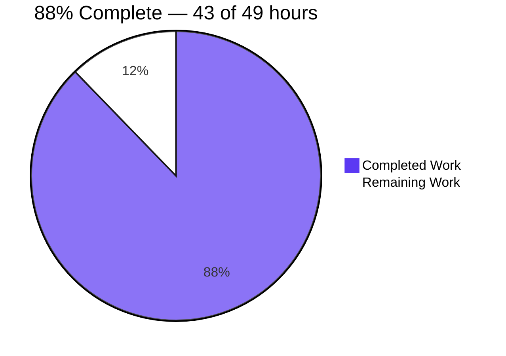
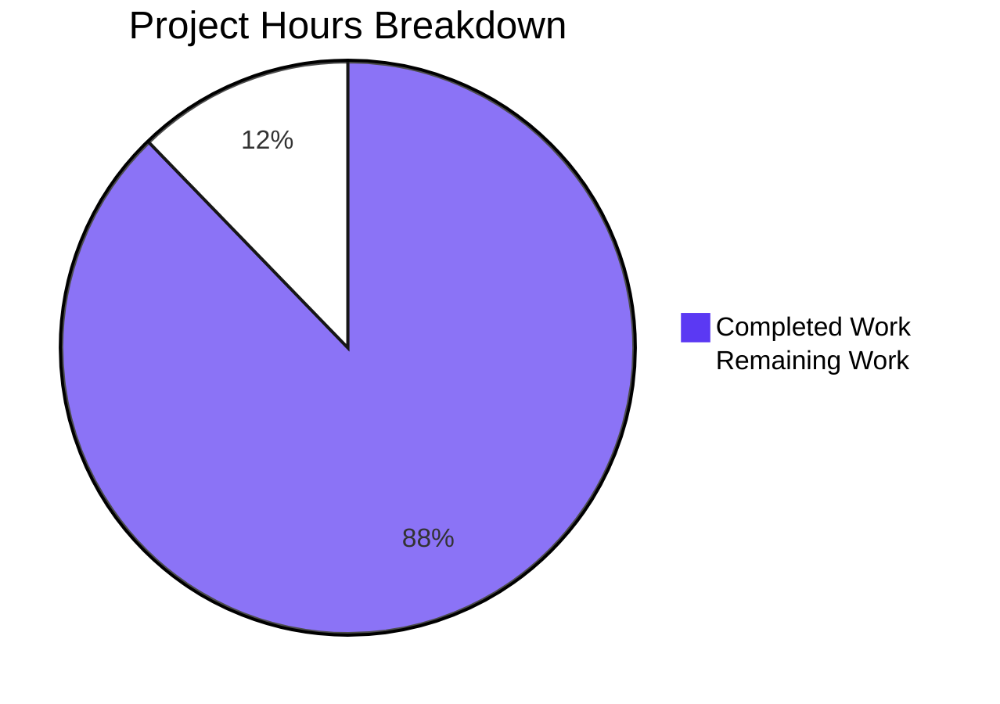

# 1. Executive Summary

## 1.1 Project Overview

A single-file, zero-dependency Node.js HTTP tutorial server: one process, one port, one route and one fallback. `GET /hello` returns `200 Hello world`; every other request the handler receives returns `404 Not Found`. Each accepted request is logged before routing, the port is validated from the environment, and Ctrl+C stops the server cleanly. There is no framework, dependency or build step, and no configuration beyond `PORT`. Its readers are developers learning Node's built-in `http` module.

## 1.2 Completion Status

43.0 of 49.0 hours complete — **88%** (43.0 / (43.0 + 6.0) = 87.8%). Every deliverable the plan scoped is delivered and verified; the remaining 6.0 hours are the path-to-production items the plan placed outside its own scope. Completed = Dark Blue `#5B39F3`; Remaining = White `#FFFFFF`.



| Metric | Hours |
| --- | --- |
| Total Hours | 49.0 |
| Completed Hours (AI + Manual) | 43.0 |
| Remaining Hours | 6.0 |

## 1.3 Key Accomplishments

- Both HTTP contracts are byte-exact: `GET /hello` → `200 text/plain`, an 11-byte `Hello world`; everything else → `404` with a 9-byte `Not Found`.
- The routing rule fails closed: query strings are dropped before matching, so `/hello/` and `//x/hello` are 404.
- Every accepted request is logged once, before routing, as an ISO-8601 timestamp, method and verbatim target.
- `PORT` is read once, defaults to 3000, accepts only an integer in 1024–65535, and refuses anything else with an actionable message and exit 1.
- Ctrl+C prints `Server shutting down`, frees the port and exits 0, and a failing console sink is reported once while the server keeps serving.
- The performance bar holds: 20/20 latency samples under 10 ms and a 50-way burst answered 50×200.

## 1.4 Critical Unresolved Issues

31 of 34 requirements are met outright and 3 fall short only structurally or environmentally (Section 5.2). Eight caveats remain open; none blocks release.

| Issue | Impact | Owner | ETA |
| --- | --- | --- | --- |
| No automated regression net (the plan excluded test frameworks) | Nothing re-checks the two contracts, the routing rule or the configuration paths when the file changes | Project owner | 2.0 h (Section 2.2) |
| SIGTERM is not handled | A supervisor stopping the service that way gets exit 143 and no shutdown line | Project owner | 1.5 h (Section 2.2) |
| The declared runtime floor is advisory and admits end-of-life lines; the Node 18.0.0/18.1.0 branch of the idle-connection guard has never run | On those versions an idle keep-alive client can delay exit by up to the keep-alive timeout, status still 0 | Project owner | 1.5 h (Section 2.2) |
| The server binds every interface with no authentication, rate limit, connection cap or explicit timeouts beyond Node's defaults | Anything that can route to the host can read both responses | Operator | Decision plus documentation (Section 2.2) |
| Every accepted request is logged verbatim and without bound | A secret placed in a URL reaches stdout, and a flood can fill the sink | Operator | Redaction/rotation policy (Section 2.2) |
| Shutdown waits for an open or slowly-dribbled request, and a repeated Ctrl+C reprints the line | A slow client can hold shutdown until it ends, bounded by Node's default request timeout | Operator | No code change; operational note |
| A request pipelined behind a `Connection: close` is dropped with its response | A pipelining client sees one response fewer; both requests are still logged | Project owner | Documentation (Section 2.2) |
| The generic non-`EADDRINUSE` bind diagnostic is not reachable on a root host | Its wording is exercised only through an injected bind failure, never a genuine one | Project owner | Verify where reachable; no code change |

## 1.5 Access Issues

No access issues identified: no credential, external service or third-party API is involved — only one TCP port.

## 1.6 Recommended Next Steps

1. [High] Release as delivered: no scoped requirement is outstanding.
2. [Medium] Add a regression net for both contracts, the routing rule and the config paths (2.0 h).
3. [Medium] Handle SIGTERM alongside SIGINT so a process manager stops the service gracefully (1.5 h).
4. [Low] Settle the runtime floor: verify the idle-connection guard on Node 18.0.0/18.1.0, or raise `engines.node` (1.5 h).
5. [Low] Document the operational posture: exposure, limits, redaction and the transport outcomes a client can meet (1.0 h).

# 2. Project Hours Breakdown

## 2.1 Completed Work Detail

| Component | Hours | Description |
| --- | --- | --- |
| Single-file HTTP server core | 12.0 | Configuration resolution and range validation, the log-then-route request pipeline, both plain-text response contracts, the truncating path extractor, the method-and-path test and the eight module constants (`server.js:5-63`) |
| Server lifecycle | 7.0 | Ordered start-up with the listeners wired before the bind, both bind-failure diagnostics, the SIGINT stop path with its exit-status mechanics and guarded idle-connection close, and the console-sink guard (`server.js:65-145`) |
| Request logging | 3.0 | The pre-routing placement rule, the ISO-8601 line shape, verbatim undecoded targets and the parser-boundary behaviour the format depends on (`server.js:28-42`) |
| Manifest and repository shape | 2.0 | The seven required manifest fields, a zero-dependency surface, no install step and no scaffold beyond the three deliverables (`package.json`) |
| Documentation deliverable | 6.0 | The eight documented items, byte-exact literals, the curl/npm/Ctrl+C/`PORT` instructions and the transport-boundary and console-sink notes (210 lines, 14 headings in `README.md`) |
| Runtime verification | 8.0 | The manual gate list executed end to end — configuration, functional, routing, logging, performance, stability, lifecycle and documentation checks — plus the uncovered paths driven directly: HEAD, CONNECT, HTTP/1.0, an oversized request line, a request pipelined behind a close, a failing console sink, an injected bind failure, SIGTERM and the non-digit `PORT` forms |
| Static review and adversarial probing | 5.0 | Contract and literal cross-checks, routing and parser probes, the console-sink investigation and the documentation-accuracy pass that produced the nine commits on this branch |
| **Total** | **43.0** | Matches Completed Hours in Section 1.2 |

## 2.2 Remaining Work Detail

| Category | Hours | Priority |
| --- | --- | --- |
| Automated regression net for both response contracts, the routing rule and the configuration paths | 2.0 | Medium |
| Supervisor-grade stop path: handle SIGTERM alongside SIGINT so a process manager stops the service gracefully | 1.5 | Medium |
| Runtime-floor verification on Node 18.0.0/18.1.0, or a deliberate decision to raise `engines.node` | 1.5 | Low |
| Operational posture and transport-caveat documentation: exposure scope, connection and timeout limits, a log redaction/rotation policy, and the pipelined-close and oversized-request-line outcomes | 1.0 | Low |
| **Total** | **6.0** | Matches Remaining Hours in Section 1.2 and the "Remaining Work" value in Section 7 |

The plan deliberately scoped out automated tests and the production apparatus (containerisation, CI/CD, process managers, hardening), replacing coverage with the manual gate list. The hours above are therefore the hardening and independent-verification steps a production owner still closes, not unfinished scoped work.

## 2.3 Hours Calculation

| Step | Value |
| --- | --- |
| Completed Hours (Section 2.1 total) | 43.0 |
| Remaining Hours (Section 2.2 total) | 6.0 |
| Total Project Hours | 49.0 |
| Completion formula | 43.0 / (43.0 + 6.0) = 87.8%, reported as 88% |
| Cross-check | Section 2.1 + Section 2.2 = 49.0 = Total Hours in Section 1.2; Remaining Hours 6.0 appears identically in Sections 1.2, 2.2 and 7 |

All scoped deliverables are complete; the 6.0 remaining hours exist because a production owner needs a regression net, a second stop signal, a settled runtime floor and an operational posture, none of which the plan's own scope included.

# 3. Test Results

The project ships no test framework by design: the plan excludes automated suites, and the manual gate list below replaces coverage. Every row is a run made against the delivered code on this host — 164 checks in total, all passing.

| Area / Category | Framework | Tests | Passed | Failed | Coverage | What This Proves |
| --- | --- | --- | --- | --- | --- | --- |
| Build, manifest and repository shape | `node --check`, JSON field inspection, tree and grep probes | 21 | 21 | 0 | No coverage tool is configured; the gate list replaces it | The file parses, the manifest carries exactly the seven required fields with no dependency field, the tree holds only the three deliverables, and no dynamic-evaluation, filesystem, outbound or `process.exit()` construct exists |
| Port configuration and validation | Shell harness driving `node` and `curl` | 47 | 47 | 0 | Manual gate list | Twelve invalid, privileged and out-of-range values are refused with the byte-exact message on stderr, empty stdout and exit 1 with nothing bound; 1024 and 65535 bind and serve; unset and empty `PORT` take the default 3000 |
| Start-up, port override and bind conflict | Shell harness | 8 | 8 | 0 | Manual gate list | The start-up line names the resolved port, an override binds only that port while the default stays unheld, and a busy port is reported actionably while the first instance keeps serving |
| Response contracts, routing and request logging | `curl`, raw sockets, log-format accounting | 45 | 45 | 0 | Manual gate list | `200`/`text/plain` with an 11-byte `Hello world` and `404`/`text/plain` with a 9-byte `Not Found` across ten unmatched or re-interpretation targets and six non-GET methods; one ISO-8601 log line per accepted request with parser-settled requests unlogged |
| Performance and stability | `curl -w`, `curl -Z`, `ps -o rss=` | 6 | 6 | 0 | Manual gate list | 20/20 sequential latency samples below 10 ms (worst 0.000674 s), a 50-way burst answered 50×200 with exactly 50 new log lines, and memory flat across 600 further requests |
| Lifecycle and console-sink robustness | Signal harness, `/dev/full` sink, injected bind failure | 16 | 16 | 0 | Manual gate list | SIGINT exits 0 with `Server shutting down` last and frees the port for an immediate rebind; a failed console write is reported once on stderr while the server keeps serving; both bind-failure messages are byte-exact |
| Documentation and package entry point | `npm start`, literal comparison against the emitted bytes | 21 | 21 | 0 | Manual gate list | `npm start` runs the server with no install step and no lockfile, and every documented literal, command and example matches what the program actually emits |

**Not Covered**

- The Node 18.0.0/18.1.0 branch of the idle-connection guard (`server.js:93-95`) was never executed: only Node 22.23.3 is available here, so the `typeof` check never takes its false path. Before relying on the declared floor, run the Ctrl+C path on 18.0.0/18.1.0 or raise `engines.node`.
- A genuine non-`EADDRINUSE` bind failure was never produced: the port range check refuses privileged ports before any bind on this host, so the generic diagnostic was reached only by injecting a bind error. Verify it on a host where such a failure occurs naturally.
- Node's own framing behaviour — the automatic `Content-Length` from a single `res.end(body)`, and its suppression for `HEAD` and for HTTP/1.0 clients — was exercised on v22.23.3 only; re-confirm if the runtime is ever brought down to an 18.x release.
- Nothing re-runs these checks automatically: there is no test file, framework or CI configuration anywhere in the tree, so a change to the routing rule or a response contract would not be caught. Add a regression net before editing either.
- No browser-driven verification applies anywhere in this project: the product has no UI, markup or client-side code, so its entire surface is two plain-text responses and console output.

# 4. Runtime Validation & UI Verification

Every line below was driven against a running instance of the delivered code; no browser applies anywhere in this project, because the product has no UI, markup or client-side code.

- ✅ **Start-up and port binding** — `Server listening on port <port>` appears exactly once with the resolved port on the default 3000, on an override, on 1024 and 65535, and through `npm start`; stderr stays empty and no other port is held.
- ✅ **`GET /hello`** — `HTTP/1.1 200 OK`, `Content-Type: text/plain` with no charset, `Content-Length: 11`, an 11-byte body with no trailing newline.
- ✅ **The fallback and the routing rule** — `404` with a 9-byte `Not Found` for `/`, `/invalid`, `/hello/`, `//x/hello`, `///x/hello`, `//evil.com/hello`, `http://evil.com/hello`, `/a/../hello`, `/HELLO` and `/hello//`, and for `POST`, `PUT`, `DELETE`, `PATCH`, `OPTIONS` and `TRACE` on `/hello`, while `GET /hello?x=1` matches and `HEAD /hello` carries neither body nor `Content-Length`.
- ✅ **Request logging** — one ISO-8601 stdout line per accepted request, in request order and before routing, with query strings, percent-encoded and long targets logged verbatim.
- ✅ **Configuration failure paths** — twelve invalid, privileged or out-of-range `PORT` values exit 1 with the byte-exact message on stderr and an empty stdout, leaving nothing bound; the accepted bounds bind and serve.
- ✅ **Bind-conflict path** — a second instance on a held port exits 1 with the byte-exact in-use message while the first keeps answering 200.
- ✅ **Graceful stop path** — Ctrl+C prints `Server shutting down` as the last stdout line, exits 0, frees the port and lets an immediate restart bind it.
- ✅ **Console-sink robustness** — with stdout on a full device the server still answers 200, reports the failed write exactly once on stderr with no stack trace and still exits 0 on Ctrl+C.
- ✅ **Concurrency, latency and memory bar** — a 50-way concurrent burst returns 50×200 with exactly 50 new log lines, 20/20 sequential latency samples stay below 10 ms, and RSS warms up then plateaus across repeated batches.
- ⚠ **Transport-level outcomes and client conditions** — a `CONNECT` request is closed with no response bytes, a malformed target or an unknown method token is refused with 400 and an oversized request line with 431, none of which reaches the handler or its log; a request pipelined behind a `Connection: close` loses its response to the socket teardown while both requests are logged; and while SIGINT is graceful, SIGTERM exits 143 with no shutdown line, and an open or slowly-dribbled request holds shutdown until it ends.

**Never exercised at runtime.** The Node 18.0.0/18.1.0 branch of the idle-connection guard, because the only runtime available is v22.23.3; a genuine non-`EADDRINUSE` bind failure, which this host cannot produce because privileged ports are refused before any bind; and any runtime other than v22.23.3, including Node's own `Content-Length` behaviour for `HEAD` and HTTP/1.0 clients. No UI, screen or browser flow exists to exercise.

# 5. Compliance & Quality Review

## 5.1 Compliance Matrix

| # | Deliverable | Benchmark it is held to | Status | Progress |
| --- | --- | --- | --- | --- |
| 1 | HTTP server creation and start-up sequencing | Built-in `http` module only, with the `'error'` and `'SIGINT'` handlers wired before the bind | ✅ Pass | 100% |
| 2 | Port configuration and validation | `PORT` read once at start-up, default 3000, integer 1024–65535, privileged ports refused with no override path | ✅ Pass | 100% |
| 3 | Matched route and response mechanics | `200`, `Content-Type: text/plain`, 11-byte `Hello world`, computed `Content-Length`, no charset, no status-message override | ✅ Pass | 100% |
| 4 | Catch-all and routing rule | `404`, `text/plain`, 9-byte `Not Found` for every other method and path the handler receives, by literal target comparison with no URL resolution | ✅ Pass | 100% |
| 5 | Request logging | One ISO-8601 line per accepted request, emitted before routing, target verbatim and never decoded | ✅ Pass | 100% |
| 6 | Bind-failure diagnostics | Actionable stderr message and exit 1 on both branches, with the first instance unaffected | ✅ Pass | 100% |
| 7 | Graceful stop path | SIGINT logs the shutdown line, closes the listener, releases idle connections and exits 0 without `process.exit()` | ✅ Pass | 100% |
| 8 | Console-sink robustness | A failed console write is reported once on stderr and the server keeps serving and still exits 0 | ✅ Pass | 100% (extends the plan's function inventory — see 5.2) |
| 9 | Manifest and dependency surface | Exactly the seven required fields with the fixed values, no dependency field, no lockfile, no install step | ✅ Pass | 100% |
| 10 | Documentation deliverable | The eight documented items with byte-exact literals, runnable commands and matching expected output | ✅ Pass | 100% |
| 11 | Performance and stability bar | Latency under 10 ms, concurrent requests not blocked, memory that plateaus | ✅ Pass | 100% |
| 12 | Security boundaries | No dynamic evaluation, no filesystem or outbound access, no persistence, constant response bodies, diagnostics confined to stderr | ✅ Pass | 100% |

## 5.2 AAP & Rule Divergences and Gaps

| # | What the Plan Required | What Was Delivered Instead | Why It Diverged | Impact | Remediation |
| --- | --- | --- | --- | --- | --- |
| 1 | Exactly eight named functions and eight module constants, "and nothing else is present" (`server.js` shape) | The same eight functions and constants in order, plus `reportConsoleWriteError`, a module-level `let` and two stream `'error'` listeners (`server.js:124-145`) | A console sink that stops accepting writes reports the failure asynchronously to the stream, so no `try`/`catch` at the call sites can reach it, and without a listener the process aborts after answering a request — the contracted exit-0 stop path becomes unreachable | Nine functions instead of eight; the request path, both bodies, all message literals, the streams and the exit codes are unchanged | None required. A purely stylistic alternative is to fold the guard inline inside `startServer()` |
| 2 | Four console messages, with their streams and exit codes | A fifth message on stderr when a console write fails (`server.js:138-141`) | Reporting a failed write needs text, and errors belong on stderr | At most one extra stderr line per run, only while the sink is unwritable | None required |
| 3 | SIGINT logs `Server shutting down` and exits 0 | The line cannot be delivered while the sink physically refuses writes; the exit status is still 0 | No implementation can write bytes to a sink that rejects them | The line is lost only in that condition, which the README documents | None required |
| 4 | `startServer()` calls `resolvePort(process.env.PORT)` | `startServer()` reads `PORT` once into a local and passes it (`server.js:100-102`) | The same plan requires the configuration to be read exactly once at start-up, which two property reads violate; the local keeps `process.env` as the source | None — behaviour, message text, stream and exit status are identical, and the message can only quote the value that failed validation | None required |
| 5 | Every other method and path returns 404, including "anything else" | Requests the transport settles itself — a `CONNECT` closure, a malformed target or unknown method token answered 400, an oversized request line answered 431 — reach neither the catch-all nor the log (`README.md:131-136`) | Answering them needs a `'connect'` listener and a third response path, both excluded by the plan's fixed single-file decomposition | The claim holds for every request the handler receives; transport-settled requests get a defined outcome with no response detail disclosed | None required; a future revision could add a `'connect'` listener |
| 6 | No line longer than a readable width | Three README lines that quote console messages verbatim (lines 150, 156, 166, at 136/104/156 characters) and the manifest's fixed description line (`package.json:4`, 101 characters) exceed 100 | The literal strings are fixed verbatim by the same plan and are compared byte for byte, and a JSON string value cannot be wrapped without altering it | Four long lines in documentation and manifest data only; `server.js` has none | None required |
| 7 | The repository starts empty, so every path is a create | `README.md` was rewritten over a 40-byte placeholder that the initial commit already tracked (+210/−2) | The placeholder was present in the starting tree | None — the placeholder is gone and the file carries all eight documented items | None required |

**1 — The ninth function and the module-level flag.** The plan fixes `server.js` at eight functions, eight constants and nothing else, so a reader comparing the file to that specification will count one function more than expected. That function exists for a specific reason: when the stream the server logs to stops accepting writes — a full disk, or a pipe whose reader has gone away — Node delivers the failure asynchronously to the stream, and a stream with no `'error'` listener re-throws it, killing the process after a request has already been answered 200 and never delivering the shutdown line. `reportConsoleWriteError` and its one-shot flag (`server.js:124-145`) report that failure once and keep serving. Nothing else in the file changed shape: the eight required functions, the constants, the ordering and every literal are as specified. Accept it as delivered, or fold the guard inline inside `startServer()` if the eight-function shape matters more than the separation.

**2 — The fifth console message.** The plan's message table fixes four messages: the start-up line, the shutdown line, the invalid-`PORT` diagnostic and the two bind-failure diagnostics (which share one table row's stream and exit code). The delivered program emits one more line, on stderr, when a console write fails: `Failed to write to the console: <reason>. Log output is lost until the console accepts writes again; the server keeps running.` (`server.js:138-141`). It is the only extra literal, it appears at most once per run, and it is emitted only while the sink is unwritable. The four contracted messages are untouched and byte-exact, and the README documents the extra line so a user comparing output against the documentation finds it there.

**3 — The shutdown line and an unwritable sink.** The plan requires SIGINT to log `Server shutting down` and exit 0. Under a sink that permanently refuses writes, the exit status is still 0 and the listener is still closed, but the line cannot physically be delivered — nothing can write bytes to a stream that rejects them. This is a property of the condition rather than of the implementation: the healthy path prints the line as the last stdout line and exits 0 in every run observed. The README states the limitation plainly, so an operator who sees no output on Ctrl+C while the log sink is broken can tell that logging is lost rather than that the process ignored the signal.

**4 — The configuration read form.** The plan's component description writes the call as `resolvePort(process.env.PORT)`; the delivered code reads `process.env.PORT` once into `rawPort` and passes that local (`server.js:100-102`). The same specification requires elsewhere that configuration be read exactly once at start-up, and the two-property-read form violates that count while making the diagnostic quote a value that could in principle differ from the one validated. The delivered form satisfies both requirements: one read, taken at start-up, used for validation and for the message. Behaviour, message text, stream and exit status are identical, and the invalid-`PORT` message still quotes the raw value exactly as supplied.

**5 — Coverage at the transport layer.** The plan states that every method and path other than `GET /hello` reaches the fallback, "including anything else". Three classes never do, because Node settles them before the request listener runs: a `CONNECT` request is closed with no response bytes, a malformed target or an unrecognised method token is answered `400`, and a request line beyond the header bound is answered `431`. None of them is logged. Answering them would require a `'connect'` listener and a third response path, both of which the plan's fixed eight-function, single-file decomposition excludes. `README.md:131-136` states the boundary, so the documented behaviour matches the product; a future revision that wants the literal claim could add a `'connect'` listener that answers 404 and logs the target.

**6 — Four lines over the readable width.** The plan prefers no line longer than a readable width. Three README lines exceed 100 characters because they reproduce console messages byte for byte — the invalid-`PORT` text (136), the in-use text (104) and the console-write diagnostic (156) — and the manifest's description line is 101 characters because a JSON string cannot be wrapped without changing its value. Both strings are fixed verbatim by the same plan and are compared byte for byte against the program's output, so literal fidelity outranks the width preference here. All three README lines carry literals only; every prose line stops at 100 characters, and `server.js` has no over-width line at all.

**7 — README written over a placeholder.** The plan records that the repository starts empty and that every path is therefore a create. The starting tree already tracked a 40-byte placeholder `README.md`, so the delivered file is a rewrite of that path rather than a creation — visible in the history as a modification with 210 lines added and 2 removed. Nothing about the deliverable is affected: the placeholder text is gone, the file carries all eight documented items with the byte-exact literals the program emits, and the tree contains only the three intended files. No action is required; the only difference is the operation label a repository-level review would record.

**Rule compliance.** The single user-specified rule states no standard, constraint, required or forbidden file, pattern or check, so it imposes nothing on the work: no file was added, renamed or dropped on its account, no rule was overridden, and no rule divergence exists anywhere in the code or documentation.

# 6. Risk Assessment

| # | Risk | Category | Severity | Probability | Mitigation | Status |
| --- | --- | --- | --- | --- | --- | --- |
| 1 | No automated regression net: nothing re-checks the two response contracts, the routing rule or the configuration paths when the file changes | Technical | Medium | Medium | Add a small suite asserting both contracts byte for byte, the fallback targets and the configuration refusals, and run it before any change to `server.js` | Open — 2.0 h in Section 2.2 |
| 2 | The listener binds every interface with no authentication, rate limit, connection cap, security headers or explicit timeouts beyond Node's defaults | Security | Medium | Medium | Restrict the network path outside the application, or add a host argument and limits before exposing the service | Open — deliberate for a local teaching server |
| 3 | Every accepted request is logged verbatim, so a secret placed in a URL reaches stdout, and log volume is unbounded (a legal target can approach 16 KB per request, with no rotation or level) | Security | Medium | Medium | Adopt an operational policy: keep secrets out of URLs, redirect stdout to a rotating sink, and treat the console as the audit trail it is | Open — mandated behaviour, no redaction |
| 4 | Only SIGINT stops the service gracefully: a supervisor sending SIGTERM gets exit 143 and no shutdown line, and an open or slowly-dribbled request holds shutdown until it ends | Operational | Medium | Medium | Handle SIGTERM alongside SIGINT, bound slow clients explicitly, and allow for the delay in whatever supervises the process | Open — 1.5 h in Section 2.2 |
| 5 | The declared runtime floor is advisory and admits end-of-life lines, and the Node 18.0.0/18.1.0 branch of the idle-connection guard has never executed | Technical | Low | Medium | Verify the stop path on 18.0.0/18.1.0, or raise `engines.node` deliberately and document the decision | Open — 1.5 h in Section 2.2 |
| 6 | A request pipelined behind a `Connection: close` is dropped with its response while both requests are logged | Technical | Low | Low | Document the outcome for pipelining clients, or serialise requests client-side | Open — documentation only |
| 7 | `resolvePort` accepts any `Number()`-coercible in-range value — hex, exponent, plus-signed, whitespace-padded and trailing-`.0` forms — so a mistyped `PORT` can bind a surprising port instead of failing loudly | Technical | Low | Low | Document the accepted forms, or tighten the validation to a digit string if that is what operators expect | Open — a deliberate departure from the plan's algorithm if changed |
| 8 | Latency and memory figures are host measurements on a shared machine, and a cold process serves roughly an order of magnitude fewer requests per second than a warm one | Operational | Low | Low | Warm the process before benchmarking and quote the host conditions alongside any figure | Accepted — reproduce the commands rather than the numbers |

Integration risk does not apply: the product has no external service, dependency, database, credential or outbound call to integrate with, and reads no environment variable beyond `PORT`. No unresolved defect risks release: every scoped requirement is delivered and every gate has been observed to pass.

# 7. Visual Project Status



Completed = Dark Blue `#5B39F3`; Remaining = White `#FFFFFF`.

The chart mirrors Section 1.2 exactly: 43.0 hours complete of 49.0 total, 6.0 remaining, **88%**.

## Remaining Hours by Category

| Category | Hours | Priority |
| --- | --- | --- |
| Automated regression net | 2.0 | Medium |
| Supervisor-grade stop path (SIGTERM) | 1.5 | Medium |
| Runtime-floor verification | 1.5 | Low |
| Operational posture and transport-caveat documentation | 1.0 | Low |
| **Total** | **6.0** | — |

## Delivered Hours by Capability

| Capability | Hours | Share of completed work |
| --- | --- | --- |
| Server core, lifecycle and logging | 22.0 | 51% |
| Runtime verification | 8.0 | 19% |
| Static review and adversarial probing | 5.0 | 12% |
| Documentation deliverable | 6.0 | 14% |
| Manifest and repository shape | 2.0 | 5% |

# 8. Summary & Recommendations

This project delivers a complete, verified, single-file Node.js HTTP tutorial server. `server.js` holds the whole application — port resolution and validation, a log-then-route request pipeline, two plain-text responses, actionable bind-failure diagnostics, a guarded SIGINT stop path and a console-sink guard — with no dependency, no build step and no configuration beyond `PORT`. `package.json` carries exactly the seven required metadata fields and no dependency surface, and `README.md` documents all eight required items with the byte-exact literals the program emits. Measured against the plan it was built from, **43.0 of 49.0 hours are complete (88%)**: every scoped deliverable and every gate is done, and the remaining 6.0 hours are the production-hardening items the plan deliberately placed outside its own scope.

What was exercised is as important as what was built. The manual gate list ran 164 checks, all passing: both response contracts byte for byte (`200` / `text/plain` / 11-byte `Hello world` and `404` / `text/plain` / 9-byte `Not Found`), the fallback across ten unmatched or re-interpretation targets and six non-GET methods, `HEAD` with neither body nor `Content-Length`, one ISO-8601 log line per accepted request emitted before routing, twelve invalid or privileged `PORT` values refused with the exact message and exit status 1, a busy port reported while the first instance keeps serving, Ctrl+C exiting 0 with the shutdown line last and the port freed, a failing console sink reported once with the server still serving, 20/20 latency samples below 10 ms, a 50-way burst answered 50×200, and memory flat across repeated batches. `npm start` runs the server with no install step, and every documented literal matches the emitted bytes.

The critical path to production is short and its shape is a set of decisions rather than missing functionality. Add a minimal regression net (2.0 h) so the contracts, the routing rule and the configuration paths are re-checked when the file changes; extend the stop path to SIGTERM (1.5 h) so a process manager can stop the service gracefully; settle the declared runtime floor by verifying the idle-connection guard on Node 18.0.0/18.1.0 or raising `engines.node` deliberately (1.5 h); and document the operational posture — exposure scope, connection and timeout limits, a log redaction and rotation policy, and the transport outcomes a client can meet (1.0 h). Nothing on that list blocks release; each item either hardens a deliberate minimalism or records a decision an operator should make knowingly.

Success for this product is measured by the contract, not by throughput: two responses that are byte-exact, a routing rule that fails closed on every target form that reaches it, a log line per accepted request, a port that refuses what it should and binds what it is told, and a stop path that exits deliberately. All of that holds as delivered, with two orders of magnitude of latency margin and stable memory, and no dependency, credential, database or external call to reconcile. Production readiness: ready as delivered for its stated purpose — a local teaching server or a dependency-free HTTP stub — with the four hardening items above as the recommended next steps before it is exposed beyond loopback or given anything to lose.

# 9. Development Guide

## 9.1 System Prerequisites

| Requirement | Version used and verified | Notes |
| --- | --- | --- |
| Node.js | v22.23.3 (`node --version`) | The manifest declares `engines.node: ">=18.0.0"`, and every language feature used exists at that floor |
| npm | 11.21.0 (`npm --version`) | Needed only for `npm start`; `node server.js` needs nothing but the runtime |
| curl | 8.14.1 | Used to exercise the endpoints by hand; any HTTP client works |
| Operating system | Linux; no platform-specific call exists | Runs unchanged on macOS and Windows |
| Hardware / services | None beyond one free TCP port | No database, cache, broker, container runtime, credential or environment file |

There is no build toolchain: the application is plain CommonJS executed directly by Node, with no bundler, transpiler, type checker or Makefile.

## 9.2 Environment Setup

1. Clone the repository and change into its root directory.
2. Confirm the application parses:

```bash
node --check server.js      # exits 0 with no output
```

3. There is nothing to configure. The only setting the program reads is the `PORT` environment variable, which is optional and defaults to 3000; no `.env` file, secret store or configuration module exists or is needed.

If Node is older than the declared floor, `npm` warns (the `engines` field is advisory) but `node` does not refuse. Confirm the runtime before starting:

```bash
node --version              # expect v18.0.0 or later; v22.23.3 was used here
```

## 9.3 Dependency Installation

None. `package.json` declares no `dependencies` and no `devDependencies`, there is no lockfile, and nothing is fetched at run time:

```bash
cd <repository-root>        # no npm install step exists or is required
node server.js              # starts immediately in a fresh checkout
```

## 9.4 Application Startup

Start in the foreground on the default port:

```bash
node server.js
# Server listening on port 3000
```

Start on a specific port by setting `PORT` on the same command line:

```bash
PORT=8080 node server.js
# Server listening on port 8080
```

Start through the package entry point (no install step, no lockfile):

```bash
CI=true npm start
# npm preamble, then: Server listening on port 3000
```

Start detached when you need the shell back, capturing the process id so you can stop exactly that process:

```bash
node server.js > server.log 2>&1 & echo $!
```

`PORT` must be an integer between 1024 and 65535. Anything else prints `Invalid PORT value "<value>": PORT must be an integer between 1024 and 65535.` on stderr and exits 1 without binding; a port already in use prints `Failed to start server: port <port> is already in use. Stop the process using that port or set PORT to a free port between 1024 and 65535.` and exits 1.

## 9.5 Verification Steps

With an instance running on the default port:

```bash
curl -si http://localhost:3000/hello
# HTTP/1.1 200 OK
# Content-Type: text/plain
# Content-Length: 11
#
# Hello world

curl -si http://localhost:3000/invalid
# HTTP/1.1 404 Not Found
# Content-Type: text/plain
# Content-Length: 9
#
# Not Found

curl -s http://localhost:3000/hello | wc -c        # 11 — no trailing newline
```

Then read the server's stdout: each accepted request produced exactly one line in the form `2026-10-21T18:41:53.785Z GET /hello`, and stderr stayed empty.

Deeper contract checks:

```bash
curl -s -o /dev/null -w '%{http_code}\n' -X POST http://localhost:3000/hello          # 404
curl -s -o /dev/null -w '%{http_code}\n' 'http://localhost:3000/hello?x=1'            # 200
for t in /hello/ //x/hello //evil.com/hello http://evil.com/hello /a/../hello; do
  curl -s -o /dev/null -w "$t %{http_code}\n" --request-target "$t" http://localhost:3000
done                                                                                  # every line 404
curl -sI http://localhost:3000/hello                                                   # 404, no Content-Length, no body
```

Stop the server and confirm the lifecycle:

```bash
kill -INT <pid>             # the equivalent of Ctrl+C
# Server shutting down      (last stdout line)
```

The process exits with status 0, the port is released, and starting the server again immediately rebinds it.

## 9.6 Example Usage

Latency — twenty sequential samples, every value in seconds and comfortably below the 10 ms target:

```bash
for i in $(seq 20); do curl -s -o /dev/null -w '%{time_total}\n' http://localhost:3000/hello; done
# 20 values, worst 0.000674 in the run recorded here
```

Concurrency — fifty parallel requests in one invocation, each expecting `200`:

```bash
curl -Z --parallel-max 50 -s -w '%{http_code}\n' $(for i in $(seq 50); do echo -o /dev/null http://localhost:3000/hello; done) | sort | uniq -c
# 50 200
```

Memory — read the resident set after a warm-up batch and again after further batches; it should plateau rather than climb:

```bash
ps -o rss= -p <pid>         # e.g. 57216 → 59104 → 59168 → 58952 KiB across 600 more requests
```

Using the server as a dependency-free stub for another program is the same two calls: `GET /hello` returns `Hello world`, and every other request returns `404`, both as `text/plain`.

## 9.7 Troubleshooting

| Symptom | Cause | Resolution |
| --- | --- | --- |
| `Invalid PORT value "abc": PORT must be an integer between 1024 and 65535.` and exit 1 | The value is not an integer in range, or is below 1024 (privileged ports are refused with no override) | Set `PORT` to an integer between 1024 and 65535, or unset it for the default 3000 |
| `PORT=0x1F90` or `PORT=" 3000 "` binds an unexpected port | Validation converts with `Number()` before the integer check, so hex, exponent, plus-signed, whitespace-padded and trailing-`.0` forms are accepted | Use a plain digit string for the port you intend |
| `Failed to start server: port 3000 is already in use. …` and exit 1 | Another process holds the port (the first instance keeps serving) | Stop the other process or start on a free `PORT` |
| `Failed to start server on port <port>: <code>. Check that the port is free and permitted for this process.` and exit 1 | A bind failure other than a busy port, such as a permission failure | Choose an unrestricted port; the range check already refuses privileged ports |
| `Failed to write to the console: <reason>. Log output is lost until the console accepts writes again; the server keeps running.` | The stream the server logs to stopped accepting writes (full disk, closed pipe) | Free the sink or restart with stdout directed somewhere writable; requests keep being served meanwhile, and Ctrl+C still exits 0 |
| Ctrl+C through `npm start` shows a non-zero exit status in the shell | npm itself receives the signal, so the shell reports npm's status even though the server printed the shutdown line and exited 0 | Send SIGINT to the node process, or read the server's own output rather than the shell's status |
| The process does not stop on `kill <pid>` (SIGTERM) | Only SIGINT is handled, so SIGTERM terminates without the shutdown line and with status 143 | Use Ctrl+C or `kill -INT <pid>`; add SIGTERM handling if a supervisor needs it |
| Ctrl+C appears to hang with a client connected | Shutdown waits for an in-flight or slowly-dribbled request to finish, bounded by Node's default request timeout | Close the client, or send SIGINT a second time; the port is released and the exit status stays 0 |
| A `HEAD` or HTTP/1.0 request shows no `Content-Length` | Node suppresses the length for `HEAD` and closes HTTP/1.0 connections instead of framing them | Expected; use an HTTP/1.1 `GET` when you need an explicit length |
| A pipelining client misses a response | A request pipelined behind one carrying `Connection: close` is dropped by the socket teardown | Send requests sequentially or on separate connections |
| `curl` reports code `000` against the port | Nothing is listening — the server is stopped, or port 3000 is being blocked by another process | Start the server and confirm the start-up line names the port you are calling |

# 10. Appendices

## Appendix A. Command Reference

| Purpose | Command |
| --- | --- |
| Check the file parses | `node --check server.js` |
| Run on the default port | `node server.js` |
| Run on a chosen port | `PORT=8080 node server.js` |
| Run through the package entry point | `CI=true npm start` |
| Run detached and capture the pid | `node server.js > server.log 2>&1 & echo $!` |
| Stop gracefully | `kill -INT <pid>` or Ctrl+C |
| Request the matched route | `curl -si http://localhost:3000/hello` |
| Request the fallback | `curl -si http://localhost:3000/invalid` |
| Check a body's exact length | `curl -s http://localhost:3000/hello \| wc -c` |
| Send a request without a body | `curl -s -o /dev/null -w '%{http_code}\n' -X POST http://localhost:3000/hello` |
| Send a target verbatim | `curl -s -o /dev/null -w '%{http_code}\n' --request-target '//x/hello' http://localhost:3000` |
| Measure latency | `curl -s -o /dev/null -w '%{time_total}\n' http://localhost:3000/hello` |
| Burst fifty concurrent requests | `curl -Z --parallel-max 50 -s -w '%{http_code}\n' $(for i in $(seq 50); do echo -o /dev/null http://localhost:3000/hello; done)` |
| Read process memory | `ps -o rss= -p <pid>` |

## Appendix B. Port Reference

| Port | Role | Notes |
| --- | --- | --- |
| 3000 | Default | Used when `PORT` is unset or empty; the examples in `README.md` use it |
| 1024–65535 | Accepted range | Inclusive at both ends; `1024` and `65535` were both bound and served |
| Below 1024 | Refused | A privileged port prints the invalid-`PORT` message and exits 1; there is no override flag |
| 8080 | Documentation example | The README's own override example |

The server binds exactly one port per process, taken from `PORT`, and passes no host argument to `listen()`, so it binds the default interfaces rather than loopback alone.

## Appendix C. Key File Locations

| Path | Role |
| --- | --- |
| `server.js` | The whole application: 9 functions, 8 module constants, the request pipeline, both responses, the configuration path, the bind-failure path, the stop path and the console-sink guard |
| `package.json` | The manifest: `name`, `version`, `description`, `main`, `scripts.start`, `engines.node`, `keywords` — and no dependency field |
| `README.md` | Purpose, prerequisites, installation, running, testing with curl, expected output, shutdown and `PORT` configuration |

| `server.js` symbol | Lines | Responsibility |
| --- | --- | --- |
| `DEFAULT_PORT`, `MIN_PORT`, `MAX_PORT`, `HELLO_PATH`, `HELLO_BODY`, `NOT_FOUND_BODY`, `TEXT_PLAIN`, `SHUTDOWN_MESSAGE` | 5–12 | The single source of every literal the program prints or returns |
| `resolvePort` | 14–26 | Validate `PORT`; return the port, the default, or `null` |
| `logRequest` | 28–33 | Write the one-line request record |
| `getRequestPath` | 35–42 | Truncate the raw target at the first `?` |
| `sendPlainText` | 44–50 | Set the status code and `Content-Type` and end the response |
| `handleRequest` | 52–63 | Log, then match `GET /hello`, else the 404 fallback |
| `handleServerError` | 65–81 | Report a bind failure and mark the process failed |
| `handleShutdown` | 83–96 | Log the shutdown line, close the listener, set exit status 0 |
| `startServer` | 98–122 | Resolve the port, wire the listeners, bind and log the start-up line |
| `reportConsoleWriteError` + the stream listeners | 124–145 | Report a failed console write once and keep serving |

## Appendix D. Technology Versions

| Technology | Version in use | Declared requirement |
| --- | --- | --- |
| Node.js | v22.23.3 | `engines.node: ">=18.0.0"` |
| npm | 11.21.0 | Not declared; used only for `npm start` |
| Runtime module | Node built-in `http` | The only module the application loads |
| Third-party packages | None | No dependency field exists in the manifest |
| Language level | CommonJS on the ES2022 surface available at Node 18.0.0 | No syntax newer than that floor is used |
| curl | 8.14.1 | Verification tool only; not a product dependency |

## Appendix E. Environment Variable Reference

| Variable | Required | Default | Accepted values | Behaviour |
| --- | --- | --- | --- | --- |
| `PORT` | No | 3000 when unset or empty | An integer from 1024 to 65535 after `Number()` conversion | Read once at start-up, validated before any socket exists, and used for the single `listen()` call. Anything else prints `Invalid PORT value "<value>": PORT must be an integer between 1024 and 65535.` on stderr and exits 1 |

No other environment variable is read anywhere in the program, and no configuration file, secret store or precedence chain exists.

## Appendix F. Developer Tools Guide

| Tool | Used for | Notes |
| --- | --- | --- |
| `node --check` | Syntax verification | The whole static check for a project with no build step |
| `node` | Running and probing the application | Also useful for field inspection: `node -e 'console.log(Object.keys(require("./package.json")).sort().join(","))'` |
| `curl` | Status, headers, body, latency and concurrency checks | `-si` for headers, `-w '%{time_total}'` for latency, `-Z --parallel-max` for bursts, `--request-target` for verbatim targets |
| `ps -o rss= -p <pid>` | Memory readings | Compare after a warm-up batch and again after further batches |
| `kill -INT <pid>` and `wait <pid>` | Stop-path verification | Read the exit status with `echo $?` |
| `git` | Inspecting the history | Nine commits describe what changed and why |
| No linter, formatter, test runner, bundler or CI tool | — | The project defines none by design; `node --check` plus the manual gate list stand in for them |

## Appendix G. Glossary

| Term | Meaning in this project |
| --- | --- |
| Fallback / catch-all | The single `else` branch of the route test: every request the handler receives that is not `GET /hello` is answered `404 Not Found` |
| Request target | The path as the client sent it, before any URL parsing; logged verbatim and truncated at the first `?` only for matching |
| Transport-settled request | A request Node answers or closes before the request listener runs — a `CONNECT` closure, a `400` for a malformed target or unknown method token, a `431` for an over-long request line |
| Console sink | The stream the program logs to (`process.stdout` for the start-up, request and shutdown lines; `process.stderr` for diagnostics); if it refuses writes, one diagnostic is reported and the server keeps serving |
| Graceful stop | Handling SIGINT by printing the shutdown line, closing the listener, releasing idle connections and exiting with status 0 without calling `process.exit()` |
| Implicit-header response | Setting `res.statusCode` and headers and ending the response with one `res.end(body)`, so Node computes `Content-Length` instead of framing the reply as chunked |
| AAP-scoped completion | The share of the work defined by the plan that is delivered and verified, expressed in hours: 43.0 of 49.0, or 88% |
